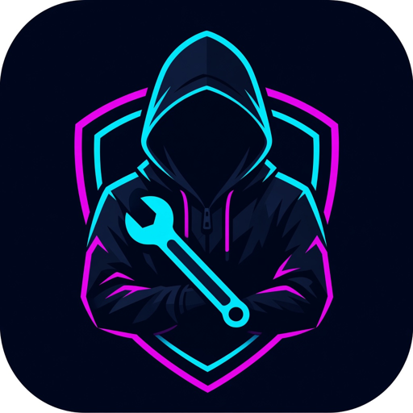

# VictorRecovery Companion

Android companion app for [VictorRecovery](https://github.com/Victorious93/VictorRecovery): install/update the recovery, schedule backups, build flash lists, and browse backups. Package id: `com.victorious.recovery`.

> **Status: experimental skeleton.** It only shows a themed start screen. No recovery features exist yet and nothing has been tested on a device.
>
> ⚠️ **Flashing can brick your phone.** It needs an unlocked bootloader (unlocking **erases all data** and may void the warranty). Back up first. Use at your own risk, no warranty.

## Build
`./gradlew assembleDebug` (JDK 17, Android SDK 34). The APK is `app/build/outputs/apk/debug/`.

## Signing (debug)
CI signs the debug APK with this project's **own fixed debug keystore**. The keystore is never in the repo. It is stored as the Actions secrets `KEYSTORE_BASE64`, `KEYSTORE_PASSWORD`, `KEY_ALIAS` and `KEY_PASSWORD`, and decoded at build time. Local builds without those variables use the default Android debug key. A debug key is not a release key: release signing will use a separate key.

## Theme
Dark neon: background `#0B0F1A`, cyan `#00E5FF`, magenta `#FF2BD6`.

## Licence
Apache-2.0, see [LICENSE](LICENSE) and [NOTICE](NOTICE).
